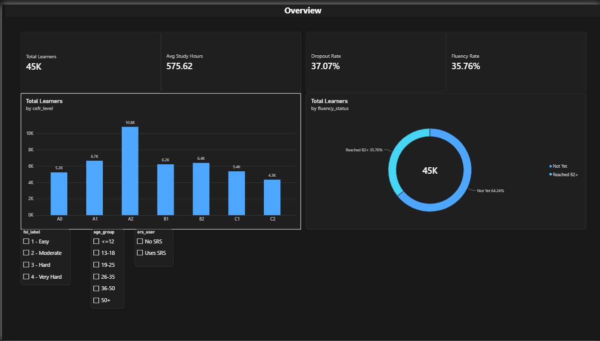
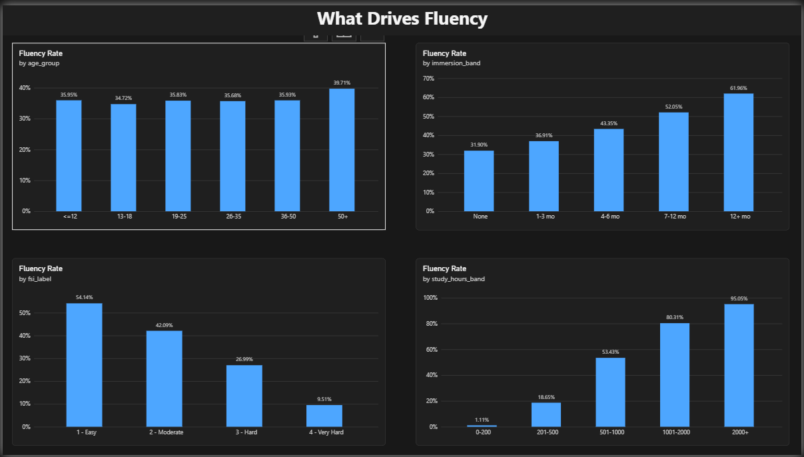
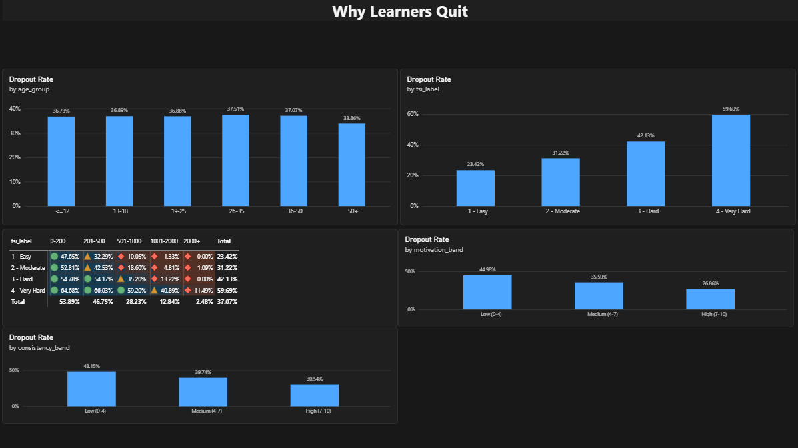
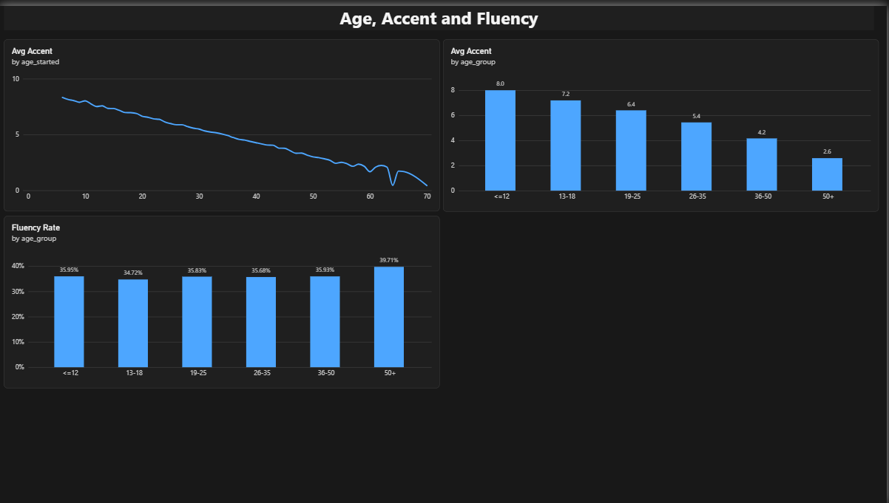

# What Gets Language Learners to Fluency?

An end-to-end data project: raw Kaggle file, Python preparation in Google Colab, and a 4-page Power BI dashboard.

**Question:** what separates learners who reach B2 or higher from those who quit?

## Dataset
[Language Learning to Fluency: Who Gets There?](https://www.kaggle.com/datasets/sergionefedov/language-learning-to-fluency-who-gets-there) by Sergio Nefedov (Kaggle). 45,000 learners, 18 columns. Downloaded with `kagglehub`; the raw file is not stored in this repo.

## Workflow
1. **Audit** the raw file: no missing values, no duplicates.
2. **Prepare features** in Python (18 to 30 columns): readable labels (`fluency_status`, `srs_user`, `fsi_label`), bands (`age_group`, `study_hours_band`, `immersion_band`), `active_use_pct`, `input_ratio`, `quality_score`.
3. **Save** the clean CSV (UTF-8 with BOM for Power BI).
4. **Dashboard** in Power BI. Sort ranks and the motivation/consistency bands are created in Power Query, because DAX columns sorted by their own source column caused a circular dependency.

## Key findings
| Factor | Result |
|---|---|
| Study hours | 1% reach fluency under 200 hours, 95% past 2,000 |
| Language difficulty | 54% (easy) down to 10% (very hard) |
| Immersion | 32% (none) up to 62% (12+ months) |
| Age | Fluency stays at 35-40%; accent falls from 8.0 to 2.6 out of 10 |
| Quitting | Quit rate falls as motivation and consistency rise |

## Dashboard
| Overview | What Drives Fluency |
|---|---|
|  |  |
| **Why Learners Quit** | **Age, Accent and Fluency** |
|  |  |

## Structure
```
reports/       client proposal (PDF) and presentation (PPTX)
dashboard/     dashboard screenshots
```

## Notebook
[Open in Google Colab](https://colab.research.google.com/drive/1v_70Do1VCtFXW_HMPP42SkTeFFKKzSam?usp=sharing)

## Limitations
- The dataset looks synthetic, so findings describe this data, not language learners in general.
- `dropped_out` means quitting before B2, so high-hour groups show low dropout by definition.
- `quality_score` is a custom index, not a validated measure.

## Tools
Python (pandas, numpy), Google Colab, Power BI Desktop.
